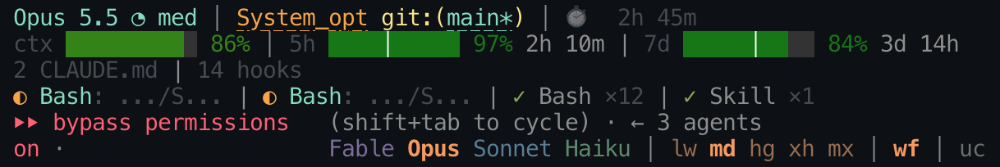

# claude-hud-controls
[English](README.md) · [한국어](README.ko.md) · [简体中文](README.zh-CN.md) · [日本語](README.ja.md)

Claude Code 프롬프트 아래에서 모델, 추론 강도, 워크플로, ultracode를 클릭으로
전환하고, 상태 표시줄 HUD에서도 같은 설정을 확인할 수 있습니다. 추론 강도를
선택하면 두 곳에 모두 즉시 반영됩니다.



위쪽은 상태 표시줄(`hud/`)입니다. 모델과 추론 강도(`Opus 5.5
◔ med`), 프로젝트와 git 브랜치가 표시되고, 이어서 컨텍스트와 5시간·7일 사용량이
남은 양으로 표시됩니다. 색상은 사용한 양에 따라 달라집니다. 맨 아래는
Claude Code의 모드 표시 옆에 있는 컨트롤 행(mod)입니다. Opus가 실행 중이며,
추론 강도 선택 항목이 펼쳐진 상태에서 `md`가 선택되어 있습니다.
워크플로(`wf`)는 켜져 있고 ultracode(`uc`)는 꺼져 있습니다.

이 저장소는 두 부분으로 구성됩니다.

| 구성 요소 | 설명 | 설치 방법 |
| --- | --- | --- |
| `hud-controls` (저장소 루트) | 프롬프트 아래에 컨트롤 행을 표시하는 Claude Code mod | `/plugin install` (아래 참조) |
| `hud/` | [claude-hud](https://github.com/jarrodwatts/claude-hud) 0.8.0을 수정한 상태 표시줄 | 복제 후 `statusLine` 설정 (아래 참조) |

각 부분은 단독으로 사용할 수 있습니다. 함께 사용하면 컨트롤 행에서 클릭한
설정이 상태 표시줄에 즉시 반영되고, 컨트롤 행에는 Claude Code가 보고한 추론
강도가 표시됩니다.

## 기능

### 컨트롤 행 (`hud-controls`)

터미널과 데스크톱 앱에서 프롬프트 아래의 안내 줄을 컨트롤 행으로 대체합니다.
Claude Code 자체 안내(`? for shortcuts`, …)는 그 위에 그대로 표시됩니다.
컨트롤 행은 버튼이 아닌 일반 텍스트로 표시되므로 포인터를 올려도 강조되거나
색상이 반전되지 않습니다. 창이 좁으면 여러 줄로 나뉘며, 나뉜 줄도 클릭할 수 있습니다.

**모델: `Fable Opus Sonnet Haiku`**

- 모델 계열마다 고유한 색상이 있습니다. Fable은 보라색, Opus는 주황색,
  Sonnet은 파란색, Haiku는 초록색입니다. 실행 중인 모델은 선명한 색상의
  굵은 글씨로 표시되고, 나머지는 흐리게 표시됩니다.
- 클릭하면 모델이 전환되고 계열 별칭(`opus`, `sonnet`, …)이 모델 설정으로
  저장됩니다. 별칭은 항상 해당 계열의 최신 릴리스를 가리키므로 컨트롤 행에는
  계열 이름만 표시됩니다. 상태 표시줄에는 정확한 버전이 표시됩니다.
  - Claude Code가 설정을 거부하면 컨트롤 행에서 대신 `/model <alias>`를 실행합니다.
- 모델을 클릭하면 추론 강도 선택 항목도 펼쳐집니다. 펼쳐진 상태에서 실행 중인
  모델을 클릭하면 선택 항목이 접힙니다.

**추론 강도: `lw md hg xh mx`** (낮음, 중간, 높음, 매우 높음, 최대)

- 선택 항목은 실행 중인 모델의 색상으로 표시됩니다. 적용 중인 강도는 굵게 표시됩니다.
- 클릭하면 프롬프트에 `/effort <level>`을 입력한 것과 동일하게 동작하며,
  확인 절차와 모델별 제한도 동일하게 적용됩니다.
- 턴이 진행 중이어도 선택한 강도가 즉시 표시됩니다.
  - Claude Code는 현재 턴이 끝난 뒤에만 플러그인의 `/effort`를 실행하므로,
    턴 도중에 클릭하면 종료될 때까지 기다립니다. 토스트로 이 사실을 안내합니다
    (`Effort high: applies when the current turn ends`).
  - 기다리는 동안 컨트롤 행의 강도는 굵은 글씨와 **밑줄**로 표시되며,
    상태 표시줄에도 이미 반영됩니다.
  - 명령이 실행되면 밑줄이 사라집니다.
- 한 턴 동안 여러 강도를 클릭하면 마지막 선택만 실행됩니다. 새로 클릭할 때마다
  이전 선택이 대체됩니다.
- 프롬프트에 직접 입력한 `/effort`도 대기 중인 클릭을 대체합니다.
  - 강도 또는 `auto`를 입력하면 대기 중인 강도 선택이 대체됩니다.
  - `ultracode on|off`를 입력하면 대기 중인 `uc` 클릭이 대체됩니다.
- 컨트롤 행에는 실제로 적용된 설정이 표시됩니다.
  - Claude Code가 강도를 거부하면 토스트에 이유가 표시되고
    (`Effort not changed: …`), 컨트롤 행은 기존 강도를 유지합니다.
  - Claude Code의 확인 요청을 거절하면 Claude Code가 유지한 강도가 표시됩니다.
  - 모델이 강도에 상한을 적용하면 제한된 강도가 표시됩니다.
  - `/effort auto` 이후에는 모델이 강도를 직접 선택하므로 아무 강도도 표시되지 않습니다.
- 컨트롤 행은 여러 경로에서 적용 중인 강도를 확인합니다.
  - 세션 시작 시에는 모델별 설정(`modelSettings`)에서 확인합니다.
  - 이후에는 메인 에이전트가 실행하는 각 턴에서 확인합니다.
  - 모든 `/effort` 응답에서 확인합니다.
  - 상태 표시줄이 설치되어 있으면 Claude Code가 상태 표시줄에 전달하는
    정보에서도 확인합니다. 확인 주기는 1초입니다.
- 모델을 전환하면 상태 표시줄이 새 모델의 강도를 보고할 때까지 기존 강도를
  유지합니다. 새 모델의 상한이나 기본값도 이때 반영됩니다.

**전환 스위치: `wf`와 `uc`**

- `wf`는 동적 워크플로를 켜고 끕니다(`workflows` 설정). 사용 중인
  Claude Code에 해당 설정이 있을 때만 표시됩니다.
- `uc`는 `/effort ultracode on` 또는 `/effort ultracode off`를 실행합니다.
  - Ultracode에는 워크플로가 필요합니다. 워크플로가 꺼져 있으면 토스트에
    `Ultracode needs Workflow turned on`이 표시됩니다.
  - 워크플로를 끄면 ultracode도 꺼진 상태로 표시됩니다.
- 스위치는 꺼져 있을 때 회색으로, 켜져 있을 때 모델 색상의 굵은 글씨로 표시됩니다.
- 턴 도중의 `uc` 클릭은 추론 강도 클릭과 마찬가지로 대기하며, 실행될 때까지
  밑줄이 표시됩니다. 실행 전에 `uc`를 다시 클릭하면 취소됩니다.

### 상태 표시줄 (`hud/`)

claude-hud 0.8.0에 다음 변경 사항을 적용했습니다.

- **평평한 막대를 사용합니다.** 모든 막대는 블록 문자 대신 한 줄의 배경색으로
  표시됩니다.
- **색상으로 사용한 양을 나타냅니다.** 컨텍스트 숫자와 막대에 동일한 색상
  척도를 적용합니다. 사용량이 적으면 짙은 초록색으로
  시작해 노란색을 거쳐, 가득 차면 빨간색이 됩니다. 사용량이 늘수록 밝아져
  사용량이 없는 막대는 흐리게, 가득 찬 막대는 눈에 띄게 표시됩니다.
  이 척도는 claude-hud의 고정 임계값과 해당 막대의 색상 재정의를 대체합니다.
- **사용 속도에 따라 사용량 색상이 바뀝니다.** 5시간·7일 막대는 해당 구간에서
  남은 시간의 비율을 가는 `│`로 표시합니다. 남은 할당량의 비율이 남은 시간의
  비율 이상이면 막대와 숫자는 초록색을 유지하고, 5%포인트 부족할 때마다
  (5, 10, 15, 20) 빨간색 쪽으로 한 단계씩 바뀌며, 25%포인트 이상 부족하면
  빨간색이 됩니다. 초기화 시간이 없으면 위의 색상 척도를 사용합니다.
- **막대는 남은 양을 나타냅니다.** `contextValue` 또는 `usageValue`를
  `"remaining"`으로 설정하면(`hud/config.json`의 설정처럼), 막대가 남은 양만큼
  채워져 옆의 숫자와 일치합니다. 남은 양이 있으면 최소 한 칸이 표시됩니다.
- **짧은 레이블을 사용합니다.** `Context`, `Usage`, `Weekly`를 각각 `ctx`,
  `5h`, `7d`로 표시합니다. `medium`은 `med`로 표시하고, 모델 이름에는 대괄호를 쓰지 않습니다.
- **사용량 줄의 배치를 안정적으로 유지합니다.** 사용량 줄의 초기화 시간에는
  괄호를 쓰지 않으며, Claude Code가 5시간 구간 정보를 보내지 않으면
  `5h --`를 표시해 배치를 유지합니다.
- **컨트롤 행과 추론 강도를 공유합니다.** 컨트롤 행에서 클릭한 강도는 턴이
  끝나기를 기다리는 동안에도 상태 표시줄에 표시됩니다. 상태 표시줄은
  Claude Code가 전달한 강도도 보고하여 컨트롤 행에 표시할 수 있게 합니다.

## 설치

### mod

Claude Code 터미널 세션의 프롬프트에서 실행합니다.

```
/plugin install hud-controls --marketplace imleben/claude-hud-controls
```

`y`로 응답해 마켓플레이스를 추가한 다음 설치 범위를 선택합니다(사용자 범위가
첫 번째 항목입니다). 컨트롤 행은 현재 세션에 즉시 나타나며, 사용자 범위로
설치하면 이후의 모든 새 세션에도 나타납니다.

셸에서 실행하려면 다음 명령을 사용합니다.

```sh
claude plugin install hud-controls --marketplace imleben/claude-hud-controls
```

`/plugin`을 실행할 수 없는 데스크톱 앱에서는 프롬프트 입력란 옆의 **+**를
클릭한 다음 **Plugins**, **Add marketplace**를 선택하고
`imleben/claude-hud-controls`를 입력한 뒤 **Add plugin**을 선택합니다.

### 상태 표시줄

상태 표시줄을 사용하려면 [Bun](https://bun.sh)이 `PATH`에 있어야 합니다.
또는 아래의 `bun`을 Bun의 전체 경로로 바꾸면 됩니다. 이 저장소를 복제합니다.

```sh
git clone https://github.com/imleben/claude-hud-controls.git ~/claude-hud-controls
```

`statusLine`을 `~/.claude/settings.json`에서 설정합니다.
`~/claude-hud-controls`가 아닌 다른 위치에 복제했다면 `plugin_dir=` 뒤의 경로를
수정합니다. 래퍼는 터미널을 기준으로 너비를 설정하고, `refreshInterval`은
상태 표시줄을 5초마다 다시 실행하여 턴 사이에도 컨트롤 행을 최신 상태로 유지합니다.

```json
{
  "statusLine": {
    "type": "command",
    "command": "bash -c 'cols=${COLUMNS:-}; case \"$cols\" in \"\"|*[!0-9]*) cols=$(stty size 2>/dev/null </dev/tty | awk '\"'\"'{print $2}'\"'\"');; esac; case \"$cols\" in \"\"|*[!0-9]*) cols=120;; esac; export COLUMNS=$(( cols > 4 ? cols - 4 : 1 )); plugin_dir=$HOME/claude-hud-controls/hud/; exec bun --env-file /dev/null \"${plugin_dir}src/index.ts\"'",
    "refreshInterval": 5
  }
}
```

위 스크린샷처럼 표시하려면 대상 위치에 설정 파일이 아직 없는 경우
`hud/config.json`을 `~/.claude/plugins/claude-hud/config.json`으로 복사합니다.
이 설정은 추론 강도, 도구, 에이전트, 할 일, 소요 시간, 설정 개수, 세션 이름을
표시하고, 7일 구간을 항상 표시하며, 컨텍스트와 사용량을 남은 양으로 표시합니다.

## 두 구성 요소가 추론 강도를 공유하는 방식

두 구성 요소는 `~/.claude/hud-controls`에서 세션마다 작은 JSON 파일 두 개를
공유합니다. 파일은 로컬 컴퓨터에만 저장되며, 프롬프트나 대화 기록 내용은 포함하지 않습니다.

| 파일 | 작성 주체 | 저장 내용 |
| --- | --- | --- |
| `<session>.json` | 상태 표시줄이 실행될 때마다 작성 | Claude Code가 전달한 모델 ID와 추론 강도, 실행 시작 시각 |
| `<session>.pending.json` | 컨트롤 행 | 클릭했지만 턴이 끝나기를 기다리는 강도 또는 `null` |

다음 두 규칙으로 컨트롤 행에 오래된 강도가 표시되는 것을 방지합니다.

- 현재 실행 중인 모델에 대한 보고만 사용합니다.
- `/effort` 응답을 받은 뒤에는 해당 응답 시점으로부터 1초가 지나기 전에
  시작된 상태 표시줄 실행의 보고를 무시합니다.

새 세션이 시작되면 종료된 세션이 남긴 대기 중인 강도를 지웁니다. 상태 표시줄은
폴더에서 7일이 지난 파일을 삭제합니다. 파일을 쓸 수 없어도 클릭한 명령은
한 번 실행되며, 상태 표시줄에만 반영되지 않습니다.

상태 표시줄이 없어도 컨트롤 행은 설정, 턴, 응답을 바탕으로 동작하며,
상태 표시줄은 Claude Code가 보고한 내용만 표시합니다.

## 확인

저장소 루트에서 실행합니다.

```sh
claude plugin validate .
claude plugin test .
```

테스트는 모의 Claude Code 환경에서 컨트롤 행을 실행합니다. 다음 항목을 확인합니다.

- 터미널과 데스크톱에서의 클릭 및 색상 표시
- 턴 도중의 클릭과 최종적으로 실행되는 클릭
- 설정 거부, 확인 요청 거절, `auto`
- 프롬프트에 직접 입력한 `/effort`
- 모델 전환을 포함한 상태 표시줄 보고
- 파일 쓰기 실패, 새 세션, 다시 로드

Claude Code 2.1.302에서 빌드하고 테스트했습니다.

## 라이선스

mod는 MIT 라이선스로 배포됩니다(`LICENSE` 참조). `hud/`는
claude-hud 0.8.0(커밋 `939eb66`)을 수정한 사본으로, MIT 라이선스이며
Copyright (c) 2026 Jarrod Watts입니다(`hud/LICENSE` 참조).
`hud/src`에서 원본과 다른 파일은 다음과 같습니다.
`effort.ts`, `index.ts`, `i18n/en.ts`, `render/colors.ts`,
`render/lines/identity.ts`, `render/lines/project.ts`,
`render/lines/usage.ts`, `render/model-display.ts`,
`render/session-line.ts`. `hud/config.json`은 새로 추가된 파일입니다.
