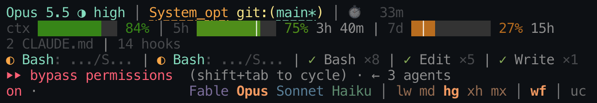

# claude-hud-controls

[English](README.md) · [한국어](README.ko.md) · [简体中文](README.zh-CN.md) · [日本語](README.ja.md)

在 Claude Code 提示符下方提供可点击的模型、思考强度、工作流和 ultracode 控件，
并配有与这些控件同步的状态栏 HUD。选择思考强度后，两处都会立即显示新设置。



上方几行是状态栏（`hud/`）：依次显示模型和思考强度（`Opus 5.5
◔ med`）、项目和 git 分支，以及上下文、5 小时和 7 天用量的剩余额度，
颜色则反映已用量。最下方是控件行（mod），位于 Claude Code 的模式标签旁。
图中正在运行 Opus，思考强度选项已展开并选中 `md`，工作流（`wf`）已开启，
ultracode（`uc`）已关闭。

本仓库包含两个部分：

| 部分 | 说明 | 安装方式 |
| --- | --- | --- |
| `hud-controls`（仓库根目录） | 在提示符下方绘制控件行的 Claude Code mod | `/plugin install`（见下文） |
| `hud/` | 修改版 [claude-hud](https://github.com/jarrodwatts/claude-hud) 0.8.0 状态栏 | 克隆仓库并配置 `statusLine`（见下文） |

两个部分均可独立使用。配合使用时，点击控件行后状态栏会立即更新，
控件行也会显示 Claude Code 报告的思考强度。

## 功能

### 控件行（`hud-controls`）

控件行会替换终端和桌面应用中提示符下方的提示行。Claude Code 自带的提示
（`? for shortcuts` 等）仍保留在其上方。控件行以纯文本绘制，并非按钮，
因此鼠标指针移过时不会高亮或反色。窗口较窄时会自动换行，换行后的内容同样可以点击。

**模型：`Fable Opus Sonnet Haiku`**

- 每个模型系列都有自己的颜色：Fable 为紫色，Opus 为橙色，Sonnet 为蓝色，
  Haiku 为绿色。当前运行的模型以加粗的完整颜色显示，其他模型则调暗显示。
- 点击模型暂时不会切换，而是展开思考强度选项，并以该模型的颜色加粗显示该模型。
  随后点击强度才会切换：与手动输入相同，先执行 `/model <alias>`（`opus`、`sonnet` 等），
  再执行 `/effort <level>`，使会话以所选强度切换到该系列的最新版本。
  要保留当前强度，请点击已经加粗的强度。控件行只显示系列名称，状态栏显示具体版本。
  - 再次点击同一模型会收起选项并取消选择；手动输入 `/model` 也会取消选择。
  - 当另一个模型的点击正在等待时，点击当前运行的模型会立即取消该点击，无需选择强度。
  - Claude Code 的确认流程与手动输入 `/model` 时相同。
  - 在轮次进行期间点击，会像手动输入 `/model` 一样立即生效：
    该轮次的下一次请求就会发送到新模型。
    - Claude Code 会将插件的 `/model` 保留到轮次结束，因此在此之前，
      控件行会将每次请求发送到 Claude Code 曾通过同一提供商发送过该系列请求的
      最新 ID（这些 ID 会跨会话记住）。命令执行前，模型以粗体并**加下划线**显示。
    - 如果 Claude Code 尚未通过此提供商向某个系列发送过请求，
      或请求带有 `[1m]` 等后缀，则会等待轮次结束。子代理保留各自的模型。
    - 只会执行最后一次点击，其强度会在对应的 `/model` 之后执行。

**思考强度：`lw md hg xh mx`**（低、中、高、超高、最高）

- 这些选项使用所显示模型的颜色，当前生效的强度以粗体显示。
- 点击的效果与在提示符处输入 `/effort <level>` 相同，也会遵循相同的确认流程和各模型的限制。
- 在轮次进行期间点击，会像手动输入 `/effort` 一样立即生效：
  该轮次的下一次请求就会使用新的强度。
  - Claude Code 会将插件的 `/effort` 保留到轮次结束，因此在此之前，
    控件行会自行在每次请求中设置强度。命令执行前，强度会以粗体并**加下划线**显示，
    状态栏也会提前显示该强度。
  - 与手动输入 `/effort` 一样，子代理保留各自的强度，Haiku 的强度不会超过 `high`，
    通过 `CLAUDE_CODE_EFFORT_LEVEL` 设置的强度也会保持不变。
- 在同一轮次中点击多个强度时，只会执行最后一次选择。每次新点击都会替换上一次选择。
- 在提示符处输入的 `/effort` 也会替换等待执行的点击：
  - 指定强度或 `auto` 会替换等待中的强度选择；
  - `ultracode on|off` 会替换等待中的 `uc` 点击。
- 控件行显示实际生效的设置：
  - 如果 Claude Code 拒绝某个强度，会通过提示说明原因（`Effort not changed: …`），
    控件行则保留原来的强度。
  - 如果你拒绝 Claude Code 的确认，控件行会显示 Claude Code 保留的强度。
  - 如果模型限制了强度上限，控件行会显示受限后实际采用的强度。
  - 执行 `/effort auto` 后，不会标记任何强度，因为此时由模型自行选择。
- 控件行会从多个来源获取当前生效的强度：
  - 会话开始时，读取各模型的设置（`modelSettings`）；
  - 此后，读取主代理运行的每个轮次；
  - 读取每次 `/effort` 的回复；
  - 安装状态栏后，还会读取 Claude Code 传给状态栏的信息，每秒检查一次。
- 切换模型后，会暂时保留当前强度，直到状态栏报告新模型的强度，
  包括该模型的上限或默认值。

**开关：`wf` 和 `uc`**

- `wf` 用于开启或关闭动态工作流（`workflows` 设置）。只有你的 Claude Code
  提供该设置时，才会显示此开关。
- `uc` 执行 `/effort ultracode on` 或 `/effort ultracode off`。
  - Ultracode 需要开启工作流。如果工作流已关闭，会显示提示
    `Ultracode needs Workflow turned on`。
  - 关闭工作流后，ultracode 也会显示为关闭状态。
- 开关关闭时显示为灰色，开启时以模型颜色加粗显示。
- 在轮次进行期间点击 `uc`，会立即在控件行和状态栏中加下划线显示。
  在执行前再次点击 `uc` 即可取消。
  - Claude Code 会将插件的命令保留到轮次结束，只有手动输入的命令才会在轮次中执行，
    而请求中也没有可供控件行设置的 ultracode 字段。因此，点击还会在提示框中填入
    `/effort ultracode on`（或 `off`），控件行则显示 **`⏎ press Enter`**。
    按 Enter 即可像手动输入一样立即生效；否则会在轮次结束时生效，
    同时该命令会从提示框中移除。
  - 控件行不会替换你正在输入的内容：如果提示框中已有草稿，
    点击后只会等待轮次结束。如果你清除或编辑该命令，Enter 提示就会消失。

### 状态栏（`hud/`）

基于 claude-hud 0.8.0，做了以下修改：

- **平面进度条。** 所有进度条都用一行背景色显示，不再使用块状字符。
- **颜色反映已用量。** 上下文的数字与进度条使用同一套色阶：
  用量较少时为深绿色，随后逐渐变黄，用满时为红色。用量越大，颜色越亮，
  因此空闲时进度条较暗，用满时则十分醒目。这套色阶替代了 claude-hud 的固定阈值，
  以及这些进度条原有的颜色覆盖设置。
- **用量使用同一套色阶。** 5 小时和 7 天进度条及数字按已用额度使用上面的色阶：
  额度全部剩余时为深绿色，用完时为红色。细线 `│` 标出窗口内剩余时间的比例，
  不会改变颜色。
- **进度条显示剩余额度。** 将 `contextValue` 或 `usageValue` 设为
  `"remaining"`（如 `hud/config.json` 中所示）后，进度条会按剩余额度填充，
  与旁边的数字保持一致。只要还有剩余额度，就至少显示一格。
- **精简标签。** `Context`、`Usage` 和 `Weekly` 分别改为 `ctx`、`5h` 和
  `7d`。`medium` 显示为 `med`，模型名称不再带括号。
- **更稳定的用量行。** 用量行中的重置时间不再带括号；当 Claude Code
  未提供 5 小时窗口时，使用 `5h --` 占位，保持布局稳定。
- **与控件行同步思考强度和 ultracode。** 在控件行点击强度后，即使还在等待轮次结束，
  状态栏也会显示所选强度。状态栏还会回报 Claude Code 传给它的强度，供控件行显示。
  状态栏的 `ultracode` 标签会立即跟随控件行的 `uc` 开关更新，
  包括手动输入 `/effort ultracode` 的情况；单独使用 claude-hud 时，
  则从会话记录中读取，而会话记录只有在下一轮次开始时才会更新。

## 安装

### mod

在 Claude Code 终端会话的提示符处输入：

```
/plugin install hud-controls --marketplace imleben/claude-hud-controls
```

输入 `y` 添加插件市场，然后选择安装范围（第一项为用户范围）。控件行会立即出现在当前会话中；
若选择用户范围，也会出现在之后的每个新会话中。

也可以在 shell 中执行：

```sh
claude plugin install hud-controls --marketplace imleben/claude-hud-controls
```

桌面应用不支持执行 `/plugin`：点击输入框旁的 **+**，然后依次选择 **Plugins**、
**Add marketplace**，填入 `imleben/claude-hud-controls`，再选择 **Add plugin**。

### 状态栏

状态栏需要 [Bun](https://bun.sh) 位于你的 `PATH` 中，也可以将下方的 `bun`
替换为 Bun 的完整路径。先克隆本仓库：

```sh
git clone https://github.com/imleben/claude-hud-controls.git ~/claude-hud-controls
```

在 `~/.claude/settings.json` 中设置 `statusLine`。如果克隆位置不是
`~/claude-hud-controls`，请修改 `plugin_dir=` 后面的路径。包装命令会根据终端
设置宽度，`refreshInterval` 则每 5 秒重新运行一次状态栏，让控件行在轮次之间也能保持更新：

```json
{
  "statusLine": {
    "type": "command",
    "command": "bash -c 'cols=${COLUMNS:-}; case \"$cols\" in \"\"|*[!0-9]*) cols=$(stty size 2>/dev/null </dev/tty | awk '\"'\"'{print $2}'\"'\"');; esac; case \"$cols\" in \"\"|*[!0-9]*) cols=120;; esac; export COLUMNS=$(( cols > 4 ? cols - 4 : 1 )); plugin_dir=$HOME/claude-hud-controls/hud/; exec bun --env-file /dev/null \"${plugin_dir}src/index.ts\"'",
    "refreshInterval": 5
  }
}
```

如需上图中的外观，且目标位置尚无配置文件，请将 `hud/config.json` 复制到
`~/.claude/plugins/claude-hud/config.json`。该配置会开启思考强度、工具、代理、
待办事项、持续时间、配置计数和会话名称的显示；始终显示 7 天窗口；
并将上下文和用量显示为剩余额度。

## 两个部分如何同步思考强度

每个会话通过 `~/.claude/hud-controls` 中的两个小型 JSON 文件共享信息。
这些文件只保存在本机，不包含提示词或会话记录内容。

| 文件 | 写入方 | 内容 |
| --- | --- | --- |
| `<session>.json` | 状态栏，每次运行时写入 | Claude Code 传给状态栏的模型 id、思考强度，以及本次运行的开始时间 |
| `<session>.pending.json` | 控件行 | 已点击但仍在等待轮次结束的强度，或 `null`，以及控件行获知 ultracode 开关状态后所显示的状态 |

以下两条规则可防止控件行显示过时的强度：

- 只有报告对应当前运行的模型时，控件行才会采用它。
- 收到 `/effort` 回复后，控件行会忽略启动时间早于该回复后一秒的状态栏运行报告。

新会话会清除已结束会话遗留的待执行强度。状态栏会删除文件夹中超过 7 天的文件。
如果无法写入文件，点击操作仍会执行一次，只是状态栏无法显示该选择。

未安装状态栏时，控件行仍可根据设置、轮次和回复正常工作；
状态栏则只显示 Claude Code 报告的信息。

## 检查

在仓库根目录执行：

```sh
claude plugin validate .
claude plugin test .
```

测试会在模拟的 Claude Code 环境中运行控件行，覆盖以下场景：

- 终端和桌面应用中的点击与颜色；
- 轮次进行中的点击、最终执行哪次点击，以及它会应用于哪些请求；
- 设置被拒绝、用户拒绝确认，以及 `auto`；
- 在提示符处输入 `/effort`；
- 状态栏报告，包括切换模型的情况；
- 文件写入失败、新会话和重新加载。

使用 Claude Code 2.1.302 构建并测试。

## 许可证

mod 采用 MIT 许可证（见 `LICENSE`）。`hud/` 是 claude-hud 0.8.0
（提交 `939eb66`）的修改副本，采用 MIT 许可证，Copyright (c) 2026 Jarrod
Watts（见 `hud/LICENSE`）。`hud/src` 中以下文件与上游不同：
`effort.ts`、`index.ts`、`i18n/en.ts`、`render/colors.ts`、
`render/lines/identity.ts`、`render/lines/project.ts`、
`render/lines/usage.ts`、`render/model-display.ts` 和
`render/session-line.ts`。`hud/config.json` 为新增文件。
